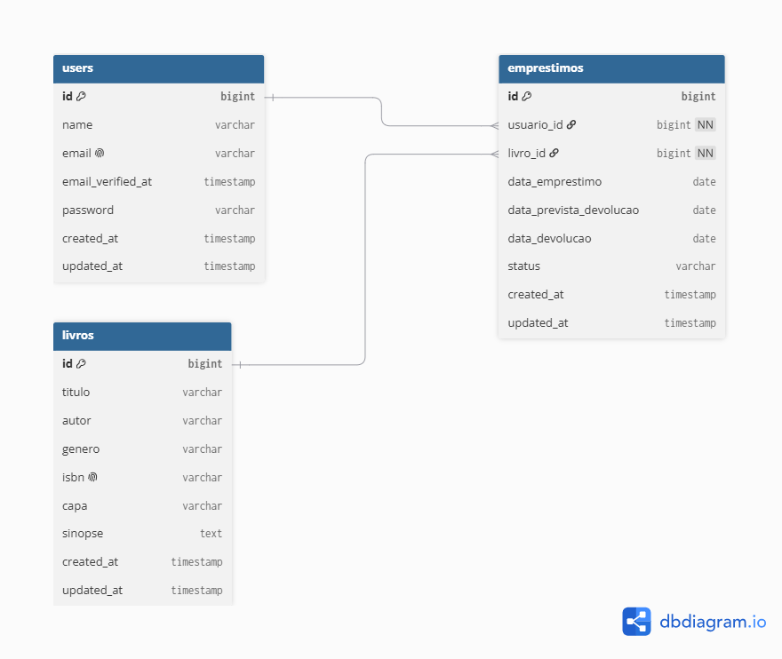

# 📚 Sistema de Gestão de Biblioteca

Projeto semestral da disciplina de Desenvolvimento Web II.

## Links de produção

- [BibliotecaTech na Vercel](https://biblioteca-sepia-beta.vercel.app/)
- [Verificação da API Laravel no Render](https://bibliotecatech-api.onrender.com/up)
- [Código-fonte no GitHub](https://github.com/tgpassos10/biblioteca)

O sistema foi desenvolvido para gerenciar:

- Livros
- Usuários
- Empréstimos

## Diagrama entidade-relacionamento



## Tecnologias utilizadas

### Front-end
- React
- Vite
- JavaScript
- CSS

### Back-end
- PHP
- Laravel
- Eloquent ORM
- API REST

### Banco de dados
- PostgreSQL

### Ambiente
- Docker
- Docker Compose

### API pública
- Open Library
## Funcionalidades

### Livros

O sistema possui CRUD completo de livros:

- Cadastrar livro
- Listar livros
- Consultar livro
- Atualizar livro
- Excluir livro

Campos principais:

- Título
- Autor
- Gênero
- ISBN
- Capa
- Sinopse

### Usuários

O sistema possui autenticação de usuários com:

- Login
- Logout
- Sessão
- Cookies

### Empréstimos

Os empréstimos fazem o relacionamento entre usuários e livros.

Cada empréstimo possui:

- Usuário
- Livro
- Data do empréstimo
- Data prevista para devolução
- Data de devolução
- Status

## Executando o projeto

### 1. Iniciar os containers

Na pasta principal do projeto, execute:

docker compose up -d

### 2. Verificar os containers

Execute:

docker ps

Devem aparecer os containers:

- biblioteca_app
- biblioteca_postgres

### 3. Executar as migrations

Execute:

docker compose exec app php artisan migrate

### 4. Acessar o Laravel

Laravel:

http://localhost:8000

API de livros:

http://localhost:8000/api/livros

API de empréstimos:

http://localhost:8000/api/emprestimos

### 5. Executar o React

Entre na pasta frontend:

cd frontend

Depois execute:

npm.cmd run dev

O React ficará disponível em:

http://localhost:5173

## Modelagem do banco de dados

O sistema possui três entidades principais:

- Usuários
- Livros
- Empréstimos

Os relacionamentos são:

- Um usuário pode possuir vários empréstimos.
- Um livro pode aparecer em vários empréstimos.
- Cada empréstimo pertence a um usuário e a um livro.

Representação:

USERS 1 ---- N EMPRESTIMOS N ---- 1 LIVROS

A tabela `emprestimos` possui as chaves estrangeiras:

- `usuario_id` referencia `users.id`
- `livro_id` referencia `livros.id`

## API pública de livros

O front-end React realiza consultas na API pública Open Library.

A pesquisa é feita utilizando o ISBN do livro.

Exemplo utilizado nos testes:

9780140328721

A consulta retorna informações como:

- Título
- Autor
- Editora
- Data de publicação
- Capa
- ISBN

Exemplo de acesso ao front-end:

http://localhost:5173

## Checklist da entrega parcial

- [x] Ambiente de desenvolvimento com Docker Compose
- [x] PostgreSQL configurado
- [x] Laravel funcionando no back-end
- [x] React funcionando no front-end
- [x] Modelagem do banco de dados finalizada
- [x] CRUD de livros via Eloquent
- [x] CRUD de empréstimos
- [x] Relacionamento entre usuários, livros e empréstimos
- [x] Rotas da API organizadas
- [x] Controllers organizados
- [x] Login funcional
- [x] Logout funcional
- [x] Sessão e cookies
- [x] Integração com API pública de livros
## Entrega final

O frontend fica em `frontend/`. Execute `npm ci` e `npm run dev` nessa pasta.
O padrão local usa React em `http://localhost:5175` e Laravel em `http://localhost:8000`.
Abra a tela React e use **Entrar na Biblioteca** para acessar o login do Laravel.
Use uma conta de teste verificada. As rotas de livros e empréstimos exigem sessão válida.
A tela permite registrar um empréstimo pelo ID do usuário e registrar a devolução.

### Publicação

- **Supabase:** configure o PostgreSQL no Laravel com `DB_CONNECTION=pgsql`,
  `DB_URL` e `DB_SSLMODE=require`. Execute `php artisan migrate --force`
  no ambiente do serviço após configurar o banco.
- **Render:** configure `APP_KEY`, `APP_ENV=production`, `APP_DEBUG=false`,
  `APP_URL` com a origem pública do Laravel e `SESSION_DRIVER=database`.
  O login do Laravel usa ativos Vite. Na raiz do back-end, gere esses ativos com
  `npm ci` e `npm run build` e inclua `public/build` na imagem de produção.
- **Vercel:** selecione `frontend/` como raiz e configure `VITE_API_URL`
  com a origem pública do Laravel, sem o sufixo `/api`.
- **Sessões em produção:** use subdomínios HTTPS do mesmo domínio registrável
  para React e Laravel. No Render, configure `FRONTEND_URL` com a origem
  exata da Vercel, `SANCTUM_STATEFUL_DOMAINS` com o host do React,
  `SESSION_DOMAIN` com o domínio compartilhado e `SESSION_SECURE_COOKIE=true`.

O React usa Axios para a API Laravel e a consulta pública por ISBN.
O painel tem acesso restrito a funcionários. Valide login, logout,
cadastro de livro, ISBN, empréstimo e devolução no ambiente publicado.

## Acesso da equipe e cadastro de leitores

Execute as migrações e provisione uma conta de funcionário pelo terminal:

```bash
php artisan migrate
php artisan biblioteca:funcionario funcionario@example.com
```

Para habilitar uma conta existente da equipe, acrescente `--promover` e confirme
a operação. Contas anteriores começam como leitores até que um operador
autorize explicitamente o acesso de cada funcionário. Os empréstimos
anteriores mantêm os mesmos vínculos. O painel cadastra leitores pelo nome e
e-mail e os disponibiliza para novos empréstimos.
